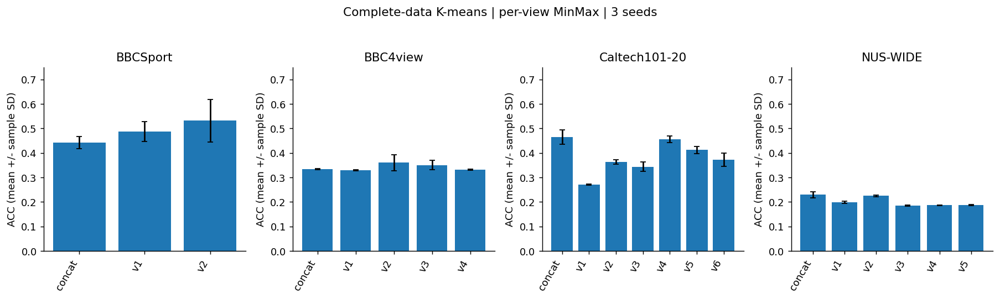

# 实验01 完整数据多视图聚类基线

状态：已运行，3个随机种子。用于建立课程要求的完整视图与特征拼接参考。

## 文件与运行

| 文件 | 用途 |
| --- | --- |
| `run.py` | 运行全部完整数据基线并绘图 |
| `config.json` | 数据集、种子、K-means停止条件和输出目录 |
| `results/complete_runs.csv` | 63条单次运行结果 |
| `results/complete_summary.csv` | 每种方法跨3个种子的均值和样本标准差 |
| `results/figures/complete_accuracy.png` | 完整数据ACC对比与误差线 |
| `results/run_config.json` | 已上传结果的原始运行配置 |
| `results/provenance.json` | 结果从统一运行目录拆分的说明 |

在仓库根目录运行：

```powershell
python experiments/01_complete_baselines/run.py
```

依赖及数据下载步骤见[根目录README](../../README.md)。这里的 `python` 应指向安装了依赖的虚拟环境。

## 协议

BBCSport、BBC4view、Caltech101-20、NUS-WIDE子集均使用全部样本和全部已提供视图。逐视图做MinMax归一化，再分别运行拼接特征K-means与各单视图K-means。K由数据集已知类别数给定；标签不参与模型拟合。

种子1、2、3；每次10个初始化，最多300轮，`tol=1e-4`，CPU线程限制为1。输出ACC、NMI、ARI、Silhouette、迭代数、聚类耗时和进程内存采样。特征预处理另列耗时，指标与文件保存不计入聚类时间。

## 已运行的拼接结果

| 数据集 | ACC均值±样本标准差 |
| --- | --- |
| BBCSport | 44.30% ± 2.47个百分点 |
| BBC4view | 33.48% ± 0.22个百分点 |
| Caltech101-20 | 46.58% ± 2.93个百分点 |
| NUS-WIDE子集 | 22.96% ± 1.23个百分点 |

完整数值以CSV为准。这些是MinMax和K-means条件下的基线，不是论文方法结果。实验02使用HOG/GIST两视图，其完整数据参考另行运行，不能直接用本实验的六视图拼接结果替代。



重新运行会在本实验 `results/labels/` 生成最终标签、真实标签和样本索引；这类可再生文件默认不上传Git。
