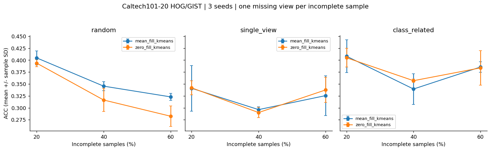

# 实验02 不完整多视图聚类基线

状态：传统基线已完成；同环境的论文方法比较、消融和表示分析见已完成的实验06A、07。

## 文件与运行

| 文件 | 用途 |
| --- | --- |
| `run.py` | 运行缺失实验、匹配视图的完整数据参考并绘图 |
| `config.json` | 视图选择、缺失模式、缺失率、种子和输出目录 |
| `results/scenario_a_runs.csv` | 54条零/均值填充运行结果 |
| `results/scenario_a_summary.csv` | 各条件的3种子均值与样本标准差 |
| `results/scenario_a_complete_reference_runs.csv` | 9条HOG/GIST完整数据参考 |
| `results/scenario_a_complete_reference_summary.csv` | 完整拼接、单HOG、单GIST的参考统计 |
| `results/mask_summary.json` | 参数值、不完整样本比例和缺失块比例 |
| `results/figures/missing_rate.png` | 三种缺失模式下的ACC曲线 |

```powershell
python experiments/02_incomplete_multiview/run.py
```

## 数据、缺失率与公平比较

数据为Caltech101-20，2386个样本、20类，选HOG 1984维与GIST 512维。保留原文件中的样本顺序，所有方法使用同一批样本、K、掩码和种子。

这里 `r=20%/40%/60%` 指不完整样本比例：选取 `floor(N*r)` 个样本，每个删除一个完整视图，不做单个特征随机删除。每个样本至少保留一个视图；实际缺失块比例约为10%/20%/30%，精确值保存在JSON和CSV中。

三种模式为随机选择缺失视图、集中缺失第一个视图、与类别相关的非随机缺失。类别信息仅供最后一种离线掩码模拟使用，不传给聚类模型。

零填充与均值填充均在已观测行拟合逐特征MinMax之后完成；均值也只从已观测行计算。两者共享预处理规则。完整数据参考单独列出，使用相同HOG/GIST输入，但可访问被模拟遮蔽的真实数据，因此是参考条件而不是相同缺失条件的可部署方法。

种子1、2、3；10次K-means初始化、最多300轮、`tol=1e-4`。不对结果挑选最佳种子。运行后还会生成 `results/masks/` 和 `results/labels/`，默认不上传。



## 与课程主实验的关系

本目录保留原CPU环境的基线结果。实验06A在统一Conda环境重新运行可比基线和HSACC，实验07完成噪声与三项消融，报告中另有真实、补全和共识的邻域比较。HSACC作者缺失参数与本实验的 `r` 定义不同，分表呈现。
