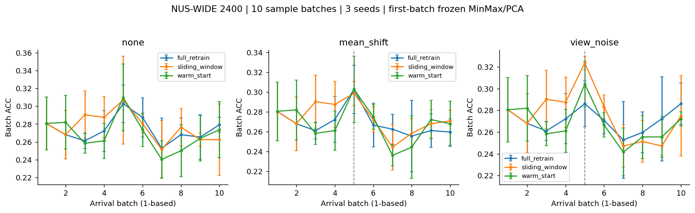
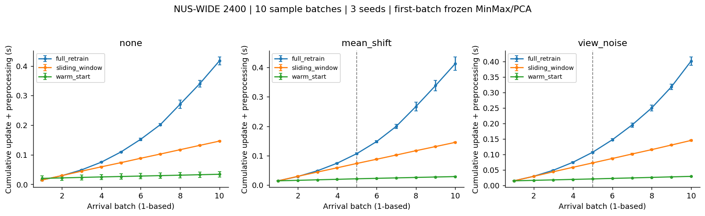
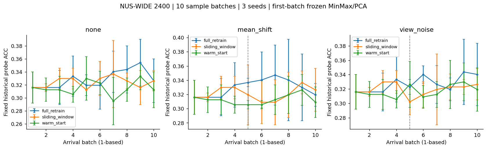
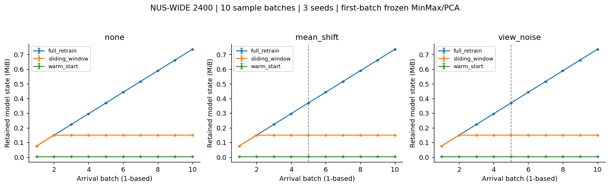

# 实验03 多视图样本流基线

状态：三种基线、无漂移与两种漂移条件已运行。论文在线改进方法尚未接入，不代表完成整个场景B。

## 文件与运行

| 文件 | 用途 |
| --- | --- |
| `run.py` | 运行流式对照并生成4张图 |
| `config.json` | 10批设置、漂移时点、窗口、时间预算与种子 |
| `results/scenario_b_runs.csv` | 270条批次评测记录 |
| `results/scenario_b_summary.csv` | 跨种子的每批统计 |
| `results/drift_recovery.csv` | 漂移下降幅度、恢复批次数及是否恢复 |
| `results/figures/stream_accuracy.png` | 每批ACC与标准差 |
| `results/figures/stream_time.png` | 累计耗时 |
| `results/figures/history_retention.png` | 固定历史探针ACC |
| `results/figures/stream_state.png` | 聚类器保留状态大小 |

```powershell
python experiments/03_streaming_baselines/run.py
```

## 协议

NUS-WIDE子集为2400个样本、5个视图、12类。每个种子先将对象随机排列，再分成10批，每批240个对象，所有视图同步到达。预处理只在首批拟合：逐视图MinMax、最多16维PCA和行归一化，拼接后在后续各批使用冻结坐标。

| 方法 | 更新时允许的历史 |
| --- | --- |
| `warm_start` | 仅上一批中心；以此初始化当前批K-means，`n_init=1` |
| `sliding_window` | 最近2批变换后的特征，10次初始化 |
| `full_retrain` | 全部已到达批次的变换后特征，10次初始化；仅作为全量重训练参考 |

每次更新后按中心距离做匈牙利匹配来对齐簇编号，不使用真实标签。当前批的ACC另做最优标签匹配。每个模型只能接收当前批特征；历史由模型自身按上表保留。

从第5批开始分别施加均值漂移或视图噪声，并与无漂移条件对照。变化仅作用于第一个视图，幅度以首批特征标准差为尺度。原始数据源由实验驱动器保存，不由在线模型访问。

种子1、2、3；单批预算预先设为30秒。已运行基线没有超过预算，此结果不推及尚未训练的论文方法。

## 稳定性、恢复和内存

历史探针取自首批，最多96个样本，由评估器持有，不能用于更新。记录探针ACC、相对首批的遗忘量以及标签匹配后变化比例。

恢复阈值为漂移前一批ACC的90%。若漂移后从未低于阈值，恢复记0；发生下降后，记录首次重新达到阈值距第5批的批次数；流结束仍未恢复时用空值并标记 `recovered=false`。无漂移条件的恢复字段不适用。

`peak_rss_mb` 是整个进程的采样工作集峰值，多个方法在一个驱动进程中顺序更新，因此不能当作隔离测得的各算法独占内存。`model_state_mb` 给出各聚类器自身保存的中心和历史数组大小，不含共享预处理器。正式效率结论还需补充隔离进程测量。









运行后会在 `results/streams/` 保存具体批次顺序，在 `results/labels/` 保存每批预测和探针结果，默认不上传。这是样本流，与实验05的视图流协议不同。
