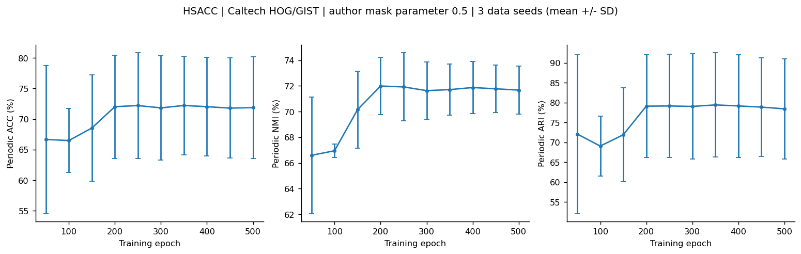
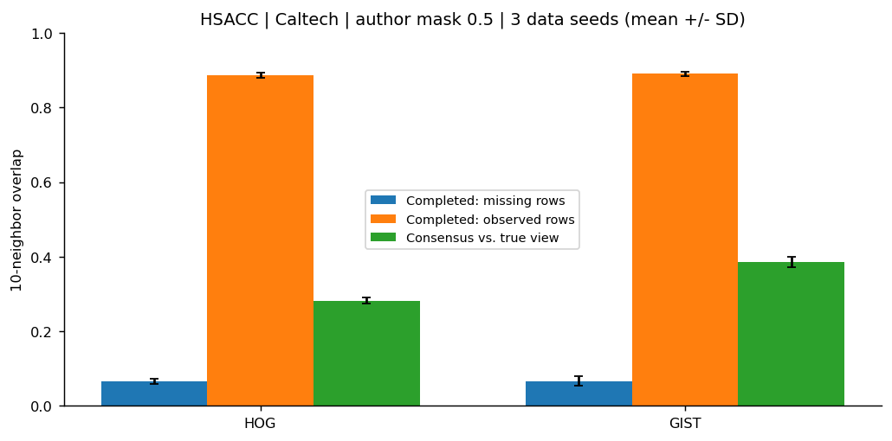
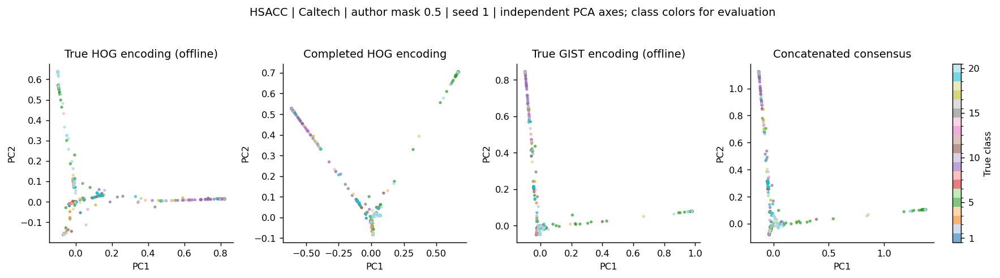

# 实验04 HSACC论文复现

**状态：已完成Caltech101-20上500轮、3个数据种子的作者代码运行。** 覆盖原论文一个数据集与缺失参数；课程统一协议和消融另见实验06、07，不代表复现原论文全部表格。

环境为Python 3.10.20、PyTorch 2.11.0+cu128、RTX 5070，详细版本在 `results/environment.json`。该环境与论文环境不同，不能把结果差异简单解释为算法差异。

## 论文与源码

- 论文：Ding等，Incomplete Multi-view Clustering via Hierarchical Semantic Alignment and Cooperative Completion，NeurIPS 2025。
- [正式论文页面](https://papers.nips.cc/paper_files/paper/2025/hash/4b2a917e30e1bb1aff055b4d8c6c081c-Abstract-Conference.html)。
- [作者代码](https://github.com/XiaojianDing/2025-NeurIPS-HSACC)，固定提交 `eb53c217a1e1ac7f8550978981e762f33cce4c97`。

## 文件与命令

| 文件 | 用途 |
| --- | --- |
| `run.py` | 本实验入口，读取配置或启动短流程检查 |
| `config.json` | 原协议首次验证设置：Caltech101-20、参数0.5、500轮、3个数据种子 |
| `../../train_or_update/run_hsacc.py` | 作者模型调用、兼容处理、结果与表示导出 |
| `../../models/author_import.py` | 从忽略的第三方源码目录导入模型 |
| `../../evaluation/neighborhood.py` | 仅用于离线真实/补全/共识邻域分析 |

先按根README安装基线和深度学习依赖、下载数据及作者资源，再运行：

```powershell
python scripts/run_in_environment.py experiments/04_hsacc_reproduction/run.py --smoke
python scripts/run_in_environment.py experiments/04_hsacc_reproduction/run.py
```

短流程为5轮、1个种子，保存在 `smoke_results/`；完整配置为500轮、3个种子，保存在 `results/`。运行前按根README指定已有解释器，启动器将所有临时文件和缓存放在项目 `.cache/`，不安装PyTorch。

## 当前已运行结果

参数为作者生成器 `missing_rate=0.5`，实际缺失块约12.3%—12.6%，并不是50%的视图块缺失。

| 固定最后一轮指标 | 3个数据种子的均值±样本标准差 |
| --- | --- |
| ACC | 71.88% ± 8.26个百分点 |
| NMI | 71.59% ± 1.74个百分点 |
| ARI | 78.38% ± 12.57个百分点 |

数值来自 `results/runs.csv` 和 `results/summary.csv`；不挑选最好种子。作者周期评估的最好结果另保存在 `upstream_best_*`，没有替代本表。训练耗时约52.17±4.27秒/次，包含作者的周期评估，不与纯K-means拟合时间直接等同。







在本配置的编码空间中，缺失行的10邻域重合率仅约6.6%，已观测行约89%。这表明较高聚类指标不等于恢复了真实样本的局部邻域；不能只展示补全后有利的聚类分数。该诊断使用训练后编码的完整真值作为参考，不是原始特征空间的重建误差。完整定量数据在 `results/neighborhood_runs.csv`、`results/neighborhood_summary.csv`。

二维图使用种子1，四个面板分别拟合PCA，坐标尺度不能直接比较；颜色来自评估标签，不参与训练。

## 协议与适配说明

采用原始6视图Caltech文件中的HOG/GIST（索引3、4），与作者双视图配置一致。`author`模式保留作者的逐视图全局MinMax、原模型结构、损失、Adam、训练循环及缺失生成器。`np.int` 的兼容替换只作用于内存副本，不改动作者原文件。

作者 `missing_rate=0.5` 是生成器参数，不是实际缺失块比例；入口会保存实际比例与掩码。作者实现用真实ACC记录周期评估中的最好结果，入口将这些数值保存为 `upstream_best_*`，同时单独导出固定最后一轮表示的ACC/NMI/ARI，不将二者混合。

固定最后一轮的独立K-means重新设置了种子，与作者内部周期K-means的随机状态可能不同。需要分别核对，不能期待两组指标完全相同。

`course`模式只用已观测数据估计标准化，并使用统一掩码；这是课程适配。课程对照及去一致性、去补全、等权变体已在实验06、07实际运行。

预期输出包括 `runs.csv`、`summary.csv`、每次运行的配置、源码校验值、`outputs.npz`、最终参数、周期评估轨迹和邻域分析JSON。完整缺失真值只在训练完成后用于离线诊断。

仓库快照保留正式CSV、图表、合并日志 `results/run.log` 和预测核验 `results/verification.json`。每种子的完整配置、源码校验、周期轨迹和邻域数据合并为 `results/reproduction_details.json`；短流程和可再生的逐次输出只留在本地。
