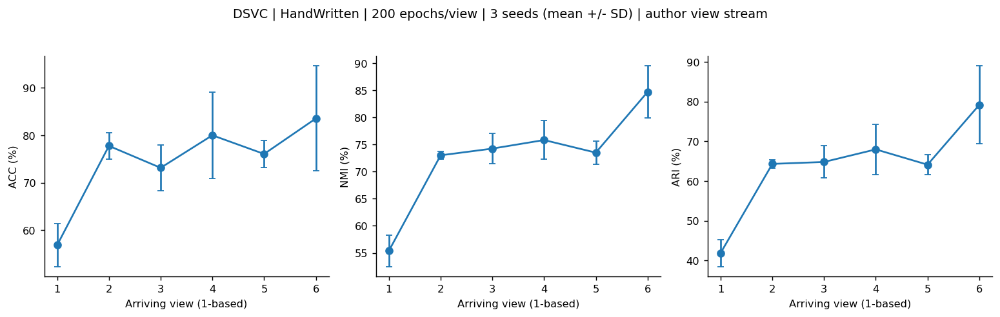

# 实验05 DSVC论文复现

**状态：已完成HandWritten上200轮/视图、3种子的作者协议运行。** 只覆盖一个数据集；课程统一协议与漂移分析已在实验06B完成。短流程输出不作为论文性能结果，也不保留在仓库快照中。

## 论文与源码

- 论文：Yuan等，Deep Streaming View Clustering，ICML 2025，PMLR 267:73526–73540。
- [正式论文页面](https://proceedings.mlr.press/v267/yuan25d.html)。
- [作者代码](https://github.com/hl-yuan/DSVC)，固定提交 `0fb55660b2418b20d9ac7cd6ed0118522a324878`。

## 文件与命令

| 文件 | 用途 |
| --- | --- |
| `run.py` | 读取本实验配置并启动运行 |
| `config.json` | HandWritten六视图、200轮/视图、3个种子 |
| `../../train_or_update/run_dsvc.py` | 调用作者网络和逐视图训练函数，保存每个视图的结果 |
| `../../scripts/download_references.py` | 下载固定提交作者代码及其随附数据 |

本实验需要可用的CUDA GPU。先完成根README中的依赖与作者资源下载，再运行：

```powershell
python scripts/run_in_environment.py experiments/05_dsvc_reproduction/run.py --smoke
python scripts/run_in_environment.py experiments/05_dsvc_reproduction/run.py
```

短流程为2轮/视图、1个种子，保存到 `smoke_results/`；原预算为200轮/视图，使用作者种子列表中的前3个11、21、22。运行前按根README指定已有解释器，启动器将临时文件和缓存统一重定向到项目 `.cache/`，不安装PyTorch。

## 协议与边界

这是同一批对象的6个视图依次到达，不是10批新样本到达。使用作者仓库随附的HandWritten数据，按作者数据加载顺序开放视图。保留作者网络、损失、原型缓冲和历史样本嵌入拼接方式。

作者 `Streaming_train.py` 默认只在第1轮和每200轮导出特征；短流程检查在内存副本中增加“最终一轮也导出”的条件，完整200轮配置不改变导出时点。作者原文件不被修改。

入口保留已安装scikit-learn版本的K-means默认 `n_init` 并记录其值；这与作者旧依赖的默认值可能不同，是本次运行保留的兼容差异。

预期输出 `runs.csv`、`summary.csv`、环境与配置、每个视图的标签和新视图表示、时间、GPU峰值分配、历史嵌入与原型缓冲大小。作者训练包含周期评估，耗时单独标注。

## 当前已运行结果

采用已有Conda环境：Python 3.10.20、PyTorch 2.11.0+cu128、RTX 5070。最终第6个视图到达后的3种子统计为：

| 指标 | 均值±样本标准差 |
| --- | --- |
| ACC | 83.53% ± 11.06个百分点 |
| NMI | 84.68% ± 4.80个百分点 |
| ARI | 79.17% ± 9.81个百分点 |

三个种子的最终ACC分别为73.00%、95.05%、82.55%；波动较大，不能以最好一次代表结果。平均累计运行时间约132.36±0.73秒，包含作者周期评估及各视图的聚类。每阶段结果见 `results/runs.csv` 与 `results/summary.csv`，已与保存的预测逐条核对。



该曲线呈现的是同一批对象逐步增加视图的结果。视图数量增多并不保证每个种子或每个指标单调提升；不将其作为新增样本流或课程显式漂移实验的结果。

该作者原协议与实验03的样本流分别报告。实验06B另完成相同视图流下的基线、显式漂移、固定时间预算和遗忘分析。正式预测核验见 `results/verification.json`，运行环境、配置、日志及源码校验保存在 `results/`。
